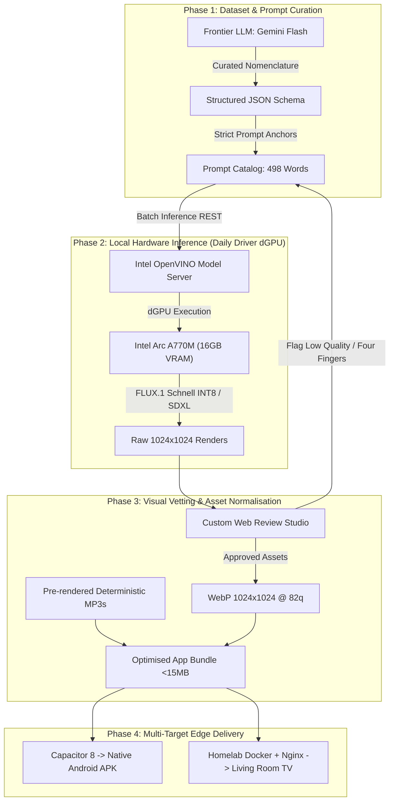

A curious reality unfolds when you hand a modern screen to a toddler: within minutes of playing what claims to be educational content on YouTube, the algorithm will quietly queue a 45-minute or one-hour unskippable commercial. Even dedicated children's applications on mobile app stores tend to fall into two traps: they either obsess over rote alphabet chanting while ignoring broader pedagogical vocabularies, or lock basic word cards behind perpetual monthly subscriptions.

As a father and lifelong backend systems engineer, I wanted something specific: a clean, zero-ad, distraction-free flashcard platform built strictly around the **Montessori 3-part nomenclature** (Concrete Object $\leftrightarrow$ Word $\leftrightarrow$ Pronunciation). 

Commercially, buying an app or paying a subscription is unquestionably cheaper than sinking dozens of engineering hours into building one. But the true return on investment in systems engineering is rarely measured in subscription savings; it is measured in **hands-on competence**. By taking on this project end-to-end, I wanted to test the contemporary frontier: how far can a seasoned backend specialist go when leveraging modern AI as a cross-functional execution engine?

Here is the operational architecture, the hardware bottlenecks, and the lessons learned from engineering and battle-testing the platform in my living room.

---

## 1. System Topology: Decoupled Multi-Tier Pipeline

Rather than treating AI as a black-box chat interface, I treated it as a distributed production pipeline. The platform needed to generate pedagogical datasets, synthesize consistent visual assets, package deterministic audio, and deliver a fluid client across native mobile and big-screen TV displays.



---

## 2. Hardware Bottlenecks: The 16GB VRAM Constraint

In an ideal commercial setup, one would simply wire high-concurrency cloud APIs to batch-process thousands of images. However, running inference locally on bare-metal hardware reveals the exact latency, thermal, and memory boundaries that whitepapers gloss over.

My daily driver workstation features a dedicated **Intel Arc A770M with 16GB VRAM**, paired with the **Intel OpenVINO Model Server (OVMS)**. My initial design attempted to keep the entire generation pipeline local:
1. Run a local 9B parameter LLM (`Qwen 3.5 9B INT4`) inside an `ovms-text` container to generate Montessori scene prompts.
2. Feed those prompts into an `ovms-image` container serving a local diffusion model on the GPU.

This design hit an immediate physical wall: **GPU VRAM collision**.

```text
[OpenCL Error]: CL_MEM_OBJECT_ALLOCATION_FAILURE
Failed to allocate 8.2 GB buffer on device /dev/dri/renderD129: Out of Device Memory
```

The text model consumed approximately 5.2 GB of VRAM, while the image diffusion pipeline demanded between 7.5 GB and 11.3 GB during active 1024×1024 latent generation. Attempting to run both concurrently resulted in immediate OpenCL out-of-memory crashes.

To circumvent this, I initially wrote orchestration scripts to swap containers on the dGPU sequentially: boot `ovms-text`, generate a batch of text, stop the container, release VRAM, boot `ovms-image`, and generate images. But this swapping overhead introduced significant latency and thermal churn. 

Worse, smaller local 9B models frequently hallucinated nonsensical physical interactions for simple words. For example, when tasked with illustrating a child wearing a shirt, the model outputted prompts describing *a child sitting trapped inside a t-shirt*. 

**The Architectural Pivot**:  
I decoupled the pipeline. I offloaded text curation to **Gemini Flash**, which eliminated hallucinations and provided toddler-safe, pedagogical scenarios with near-zero failure rates. This left the local Intel Arc A770M **100% dedicated to image diffusion**, running continuously and uninterrupted at roughly **11 seconds per image**.

---

## 3. The 80% Discard Rate and the "Four-Finger" Reality

Diffusion models excel at landscapes and abstract art, but child anatomy remains a notorious weakness. In early batch runs, I had to discard nearly **80% of generated images**. The failure modes were stark:
* Disembodied limbs floating in the background.
* Grotesque hand anatomy—predominantly hands depicting **four fingers** (one thumb and three elongated digits) instead of five.
* Inconsistent artistic styles: without strict prompt constraints, one card looked like a 3D Pixar render, the next like an oil painting, and the third like an ink sketch.

```
       Generated Image (Observed Anatomy Flaw)
   ┌──────────────────────────────────────────────┐
   │                                              │
   │           \ | /   (Waving Hand)              │
   │          ┌─────┐                             │
   │          │  │  │  <-- 3 Fingers + 1 Thumb    │
   │          │  │  │      (Missing 5th digit)    │
   │          └──┴──┘                             │
   │                                              │
   │  "Children storybook kid waving hand"        │
   │  Model: FLUX.1 Schnell / SDXL on OVMS        │
   │  Inference Latency: 10.77s on Arc A770M      │
   └──────────────────────────────────────────────┘
```

To manage this, I had my AI pair-programmer build a local **Visual Vetting Studio** (a lightweight browser gallery). This allowed me to rapidly review batches of 32 cards, hit `[F]` to flag anatomical mutants for deletion, and trigger automated regeneration.

To solve the style divergence, I locked every generation behind a non-negotiable **system prompt visual anchor**:

```text
flat 2D vector illustration, modern children's picture book art, bold smooth clean outlines, 
isolated subject, centered composition, solid soft cream background, vibrant cheerful pastel colors, 
storybook art style, minimalist, kid-friendly, clean cute anatomy, wordless visual art, 
zero text, no words, no letters, no labels, no typography
```

This visual anchor brought order to the chaos, ensuring that when cards were shuffled, the deck felt like a cohesive, professionally illustrated storybook rather than an incoherent collage.

---

## 4. Frontend & Audio Engineering: Edge Realities

With the visual dataset stabilized across 498 Montessori curriculum words, building the client application surfaced classic edge constraints across mobile and television environments.

### The Audio Pivot: Why WebSpeech Was Stripped
The browser's native `SpeechSynthesis` API initially seemed like an elegant zero-dependency choice for word pronunciation. In production testing, however, it proved fragile:
* Budget Android phones and Android TVs frequently lack localized high-quality voice data packs due to limited onboard storage.
* Some television WebView implementations disable synthetic speech engines entirely or introduce unpredictable audio latency.

To ensure deterministic reliability, I stripped out the WebSpeech API completely. Instead, I pre-generated **discrete, normalized MP3 audio files** for every single vocabulary term. Bundling static MP3 assets guaranteed consistent pronunciation and 100% offline playback on any hardware without relying on the host OS speech subsystem.

### Svelte 5 and the 3-Card Virtual Window
The frontend was engineered with **Svelte 5** (leveraging modern Runes like `$state` and `$derived`), bundled with **Vite 6**, and styled with **Tailwind CSS**. 

On modern smartphones, loading 498 high-resolution 1024×1024 illustrations is trivial. On an entry-level smart TV running an under-powered system-on-chip with 1GB of shared RAM, however, unconstrained DOM image retention causes quick memory leaks and browser crashes (OOM).

I implemented a **rolling 3-image virtual window**:
* The current card rendered on screen.
* The next card preloaded silently in memory for instantaneous zero-latency navigation.
* The previous card explicitly dereferenced and purged from DOM memory.

This bounded DOM memory usage to a flat $O(1)$ ceiling, allowing hours of uninterrupted playback on budget TV hardware.

```svelte
<!-- Svelte 5 Rune-based Navigation Engine -->
<script lang="ts">
  let currentIndex = $state(0);
  let deck = $props.deck;

  // Derive bounded 3-card rolling window to protect device memory
  let activeCard = $derived(deck[currentIndex]);
  let nextCard = $derived(deck[(currentIndex + 1) % deck.length]);

  function advance() {
    currentIndex = (currentIndex + 1) % deck.length;
  }
</script>

<svelte:window onkeydown={(e) => {
  if (e.key === 'ArrowRight' || e.key === 'Enter') advance();
}} />
```

---

## 5. Deployment and the Solo Publisher Barrier

The resulting application was packaged in two distinct formats:
1. **Docker Container**: Running an Nginx Alpine static server on my homelab, hooked up via HDMI/network to the living room TV with full D-Pad remote control navigation (`ArrowLeft`, `ArrowRight`, `Enter`, `Space`).
2. **Native Android APK**: Built via **Capacitor 8**, bundling all 498 compressed WebP illustrations and MP3 audio clips into a self-contained **sub-15 MB standalone package** that runs entirely offline.

Once the English application was complete, the decoupled architecture allowed me to port the entire platform to **Chinese (Mandarin), Malay, Cantonese, Japanese, and Tamil** with minimal effort.

### Why It Isn't on the Google Play Store
A natural question is: why not publish this to the Google Play Store for other parents?

In late 2023, Google introduced stringent requirements for personal developer accounts: individuals must recruit **20 opt-in testers who remain actively opted-in for at least 14 consecutive days** before being permitted to apply for production access. Furthermore, Google mandates the public legal disclosure of personal home addresses on app store listings for individual developers.

For an engineering leader building software for his family, navigating that administrative friction makes little sense. To distribute professionally without exposing personal privacy, one must establish a formal corporate entity (such as an LLP). For now, sideloading the APK and streaming via homelab Docker fulfills the mission with zero corporate overhead.

---

## 6. Living Room Beta Testing: The Human Factor

Deploying software to production is straightforward; deploying software to your own children is humbling.

When I booted the app on the living room TV, the immediate victory was the total absence of commercial exploitation. There were no 60-minute unskippable ads, no subscription banners, and no frantic visual clutter. The Montessori nomenclature did its job: clear image, clear spoken word, repeated calmly.

However, young children quickly provide a reality check on attention economics:
* While engaging, their focused attention span naturally peaks around **10 to 15 minutes**.
* They did not care whether an illustration was generated by AI or drawn by a human artist; they cared whether the card was recognisable and intuitive.
* They didn't notice the occasional four-fingered hand, but they immediately noticed if an image didn't match their mental model of the object.

---

## 7. Strategic Takeaways for Engineering Leadership

Reflecting on this build yields three core perspectives for engineering directors and technical architects:

### 1. The Collapse of Siloed Engineering Roles
Historically, building this product would have required a multi-disciplinary team: a product manager for scoping, a UX designer for wireframes, a frontend engineer for Svelte, a mobile dev for Android packaging, and a QA engineer for regression testing. 

With AI orchestration, a single engineer with strong systems architectural fundamentals can comfortably execute the entire lifecycle. The primary differentiator for technical talent is no longer narrow domain syntax, but **the ability to orchestrate autonomous tools, evaluate trade-offs, and enforce architectural constraints**.

### 2. Quota Management vs Bare-Metal Infrastructure
Modern AI development requires understanding the financial and technical trade-offs between managed APIs and self-hosted open models:
* Frontier cloud APIs (Gemini Flash) provide unmatched semantic reasoning and near-zero hallucination rates for pennies.
* Local bare-metal inference (Intel Arc + OVMS) offers unmetered image generation and zero data leakage, but introduces hard physical constraints around VRAM limits and thermal ceilings.
* Knowing when to hybridize the two is the hallmark of practical systems architecture.

### 3. Real Competence Comes From Hands-On Scars
It is easy to hold high-level opinions on AI and modern web stacks when reading vendor whitepapers. But until you have debugged OpenCL memory allocation faults on a local dGPU, managed DOM memory leaks on an Android TV WebView, and filtered out hundreds of four-fingered cartoon children, your understanding remains purely academic.

The highest return on investment in technology is the continuous willingness to build, break, and master real systems.
