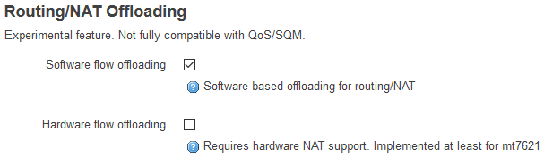
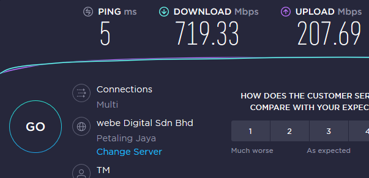

When transitioning home lab infrastructure or high-bandwidth residential uplinks to gigabit tiers (such as TM UniFi Turbo 800 Mbps), embedded routers frequently encounter a severe bottleneck: CPU saturation during Layer 3 packet forwarding and Network Address Translation (NAT).

Stock vendor firmwares frequently utilise proprietary hardware NAT acceleration shortcuts to sustain gigabit routing on modest System-on-Chip (SoC) architectures. Replacing vendor firmware with OpenWRT yields vast security, auditability, and configuration gains, but traditionally forced every packet through the full Linux kernel `netfilter` stack, collapsing throughput on sub-gigahertz single-core MIPS CPUs to ~250–300 Mbps.

The introduction of **Flow Offloading** in OpenWRT 19.07 fundamentally changed this equation by introducing a fastpath that bypasses redundant kernel processing for established flows.

---

## The Linux Netfilter Bottleneck

In a conventional Linux routing environment, every single ingress packet must traverse the full evaluation pipeline:

1. Ingress network driver ring buffers and socket buffers (`sk_buff`).
2. Netfilter `PREROUTING` chain evaluation.
3. Connection tracking (`conntrack`) table lookup and state inspection.
4. Routing decision (FIB lookup).
5. Netfilter `FORWARD` chain rule traversal.
6. `POSTROUTING` evaluation and Source NAT (SNAT/Masquerade) rewriting.
7. Egress transmission.

For long-lived, high-throughput bidirectional streams (such as multi-hundred-megabit file transfers, steam downloads, or raw speed tests), running every 1500-byte MTU frame through this entire gamut consumes excessive CPU instruction cycles. On an Atheros QCA9558 single-core MIPS processor clocked at 720 MHz (the backbone of the TP-Link Archer C7 v2), the CPU hits 100% software interrupt (`si`) saturation well before reaching line rate.

```
Conventional Path:
[ Ingress Packet ] ──> [ PREROUTING ] ──> [ Conntrack ] ──> [ Routing Table ] ──> [ FORWARD ] ──> [ POSTROUTING ] ──> [ Egress ]
                             │                  │                                    │                  │
                             └──────────── Evaluated for EVERY single frame ─────────┴──────────────────┘

Flow Offloading Fastpath:
[ Ingress Packet ] ──> [ Flowtable Cache Lookup ] ─────────(Match: Fast Forward)─────────> [ Egress (L2/L3 Rewritten) ]
                             │ (Miss)
                             └──> [ Fall back to slowpath netfilter stack ]
```

---

## Architectural Mechanism: The Flowtable Fastpath

Flow offloading leverages `nftables` flowtables in the Linux kernel. When a TCP or UDP bidirectional flow passes through connection tracking and establishes its initial three-way handshake, the kernel registers the flow into an in-memory hardware or software flowtable.

Subsequent packets belonging to this active tuple bypass:
- The `iptables` / `nftables` rule traversal.
- Repeated connection tracking state queries.
- Repeated route cache lookups.

Instead, the network driver reads the destination MAC, source MAC, and L3 addresses directly from the flowtable entry, updates the checksums, and dispatches the packet immediately to the egress interface queue.

### Software vs. Hardware Offloading: Hardware Architecture Realities

OpenWRT offers two offloading modes:

1. **Software Flow Offloading**: Implemented in pure Linux kernel code. It runs on the CPU but slashes per-packet instruction overhead. This operates across virtually all network chipsets.
2. **Hardware Flow Offloading**: Offloads flow forwarding directly to hardware packet acceleration engines inside the Ethernet switch silicon (common in MediaTek MT7621/MT7622 and Qualcomm Atheros PPE chipsets).

> [!NOTE]
> Hardware flow offloading requires explicit silicon driver hooks. On devices like the TP-Link Archer C7 v2 (QCA9558 MIPS), the integrated switch core lacks open-source hardware flow acceleration driver support. As such, software flow offloading must be used exclusively. Attempting to enable hardware offload on unsupported chipsets is either silently ignored or may cause driver instability.

---

## Implementation & Tuning

### Step 1: Upgrading & Package Verification

Flow offloading requires OpenWRT 19.07 or later with `kmod-ipt-offload` or `kmod-nft-offload`:

```bash
# Verify active kernel version
uname -r

# Verify flowtable kernel module availability
opkg update
opkg list-installed | grep -E "kmod-ipt-offload|kmod-nft-offload"
```

### Step 2: Enabling the Fastpath

In the OpenWRT web interface (LuCI), navigate to **Network > Firewall**. Under **General Settings**, locate **Routing/NAT Offloading**:



Alternatively, configure `/etc/config/firewall` directly via the CLI:

```uci
config defaults
    option flow_offloading '1'
    option flow_offloading_hw '0'
```

Commit the change and restart the firewall service:

```bash
uci commit firewall
/etc/init.d/firewall restart
```

---

## Benchmark Results: 300 Mbps to 720+ Mbps

Before enabling software flow offloading on the 800 Mbps UniFi fibre connection, line throughput on the Archer C7 plateaued at **290–310 Mbps**, with `htop` reporting 99–100% CPU utilisation in `ksoftirqd`.

Upon activating software flow offloading:



- **Throughput**: Jumped immediately to **719 Mbps** downstream.
- **CPU Overhead**: dropped significantly, leaving headroom for concurrent DNS queries and administrative telemetry.

---

## Architectural Trade-offs & Production Considerations

While flow offloading delivers a dramatic performance boost, engineering leaders must recognise its trade-offs:

1. **Incompatibility with Smart Queue Management (SQM)**:
   Because packets bypass the standard kernel queuing disciplines (`qdisc`), advanced Active Queue Management (such as CAKE or `fq_codel`) cannot intercept or schedule offloaded flows. If your uplink experiences significant bufferbloat, you must evaluate whether you prioritise raw gigabit throughput or deterministic latency guarantees under saturation.
2. **Per-Packet Firewall Logging & Inspection**:
   Packets traversing the fastpath do not trigger per-packet `iptables` logging rules. Flow accounting and byte counters continue to synchronise periodically back to conntrack, but packet-level DPI or IDS/IPS hooks will not evaluate every intermediate packet.
3. **Failover Behaviour**:
   If an established flowtable connection drops or terminates (via TCP FIN/RST or timeout), the flow entry is evicted, and any new handshake naturally returns to the slowpath for security policy evaluation.
